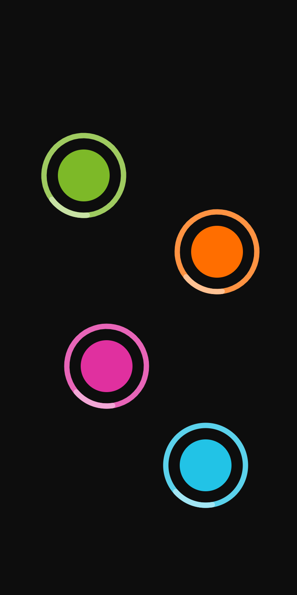
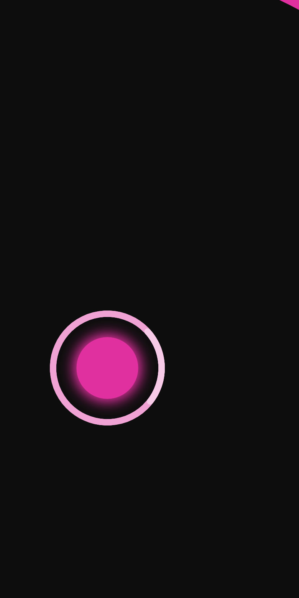
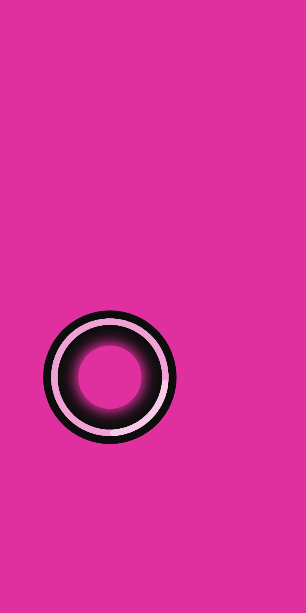
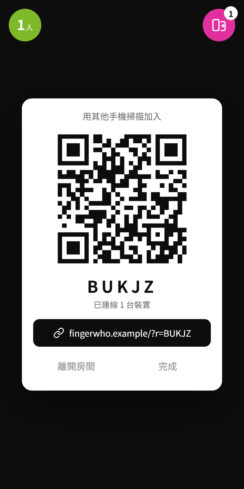
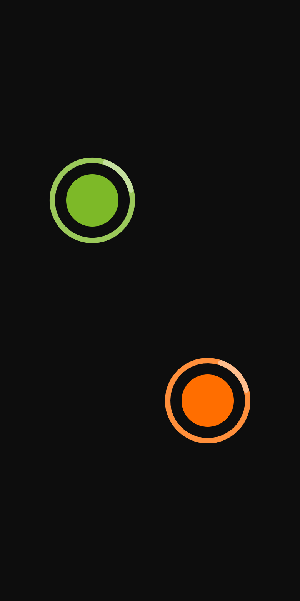
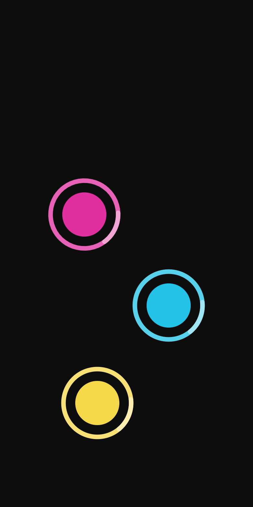

# FingerWHO

**大家把手指放上螢幕，3 秒後隨機選出一個人。手機不夠大？多拿幾台手機連線一起玩。**

*A finger chooser for the web. Everyone puts a finger on the screen and one gets picked. Too many people for one phone? Link a few phones and play as one.*

🔗 線上試玩：**[fingerwho.playfuni.net](https://fingerwho.playfuni.net)**

<p>
  
  
  
</p>

## 為什麼做這個

這個 app 的靈感來自 [Chwazi Finger Chooser](https://apps.apple.com/us/app/id689674978)。大家把手指放在同一支手機上，它會隨機選一個人，用來決定誰先手、誰買單、誰去倒垃圾都很好用。

不過實際玩的時候碰到兩個問題：

- **iPhone 一次只抓得到 5 根手指。** 6 個人以上就不能玩了，Android 也要看機型。
- **一支手機的螢幕太小。** 一群人圍著擠，手指常常互相擋住。

所以我們做了一個網頁版，**讓好幾支手機連線變成同一場遊戲**：

- 每支手機只顯示放在自己螢幕上的手指，但所有手指一起抽。
- 全場每根手指的顏色都不一樣，不管它在哪支手機上。
- 結果動畫在所有手機上同時播出：被選中的顏色填滿每支手機的螢幕，大家一看就知道是誰。
- 不用安裝 app，打開網頁就能玩。另一支手機掃 QR code 就能加入。

## 怎麼玩

1. 打開網頁，大家各放一根手指上去。
2. 手指都不動，3 秒倒數結束就揭曉。中途有人多放或抬起手指，倒數就重來。
3. 被選中的手指會亮起來，它的顏色填滿螢幕，停一下再退回黑色。

只有兩個設定：

| 左上角 | 右上角 |
|---|---|
| **選幾人**：一次要選出幾個人（1–9） | **多機連線**：產生房間和 QR code，其他手機掃描就能加入 |

### 多支手機一起玩

<p>
  
  
  
</p>
<p>
  
  
</p>

上排：手機一放了兩根手指，手機二放了三根，全場五種顏色都不一樣。下排：揭曉時兩支手機同時變成被選中的綠色，手機一（被選中的人在這台）會留下那根手指。

- **隨時都能玩。** 房間還在連線、或其他人還沒加入時，這支手機照樣可以自己玩。連上之後下一回合就自動變成大家一起玩。
- **每台放一根就夠。** 手指數是所有手機加起來算的。
- **離開房間**：在右上角的面板裡。超過 30 分鐘沒用的房間連結，重新打開時會自動回到單機模式。

## 技術上怎麼做到同步

- **一份規則，兩個地方跑。** 所有遊戲規則（顏色分配、倒數、重來、抽人）都寫在 [`lib/room.ts`](lib/room.ts)。單機時在瀏覽器裡跑；多機時在伺服器上跑同一份程式。
- **伺服器決定結果，大家一起播動畫。** 每支手機會先跟伺服器對時，誤差通常在幾十毫秒內。倒數快結束前，伺服器就先選好人，告訴每支手機「在某個時間點開始播」，所以網路延遲不會讓各台的動畫錯開。
- **跑在 Cloudflare 上。** 網頁是 Next.js 匯出的靜態檔案；每個房間是一個 [Durable Object](https://developers.cloudflare.com/durable-objects/)，透過 WebSocket 連線。免費方案就夠用，而且不會休眠。

```
lib/room.ts        遊戲規則（瀏覽器和伺服器共用）
lib/transport.ts   單機／連線切換、對時
lib/render.ts      Canvas 動畫
components/        畫面和觸控
worker/index.ts    Cloudflare Worker + 房間的 Durable Object
server.ts          本機開發用的 Node 伺服器（同樣的 /ws 協定）
```

## 本機開發

```bash
npm install
npm run dev
```

- 一定要用 `npm run dev`，它會跑 `server.ts`。直接跑 `next dev`（包括 WebStorm 內建的 Next.js 執行設定）不會有 `/ws` 連線服務，多機模式會一直顯示「連線中」。
- 伺服器會印出區網網址（例如 `http://192.168.x.x:3000`）。手機連同一個 Wi-Fi，打開那個網址就能測試。
- 在電腦上用滑鼠點畫面，會放下一根「假手指」，再點一次就拿起來。
- 規則檢查：`npx tsx scripts/room-check.mts`。

想在本機用 Cloudflare 的執行環境測試：`npm run cf:dev`，然後打開 http://localhost:8787。

## 部署

部署用 Cloudflare 的 Git 連線（Workers Builds）。推送到 `master` 時，Cloudflare 會自動打包並更新網站，不用設定任何 API token。

第一次設定：Cloudflare 後台 → Workers & Pages → fingerwho → Settings → Builds → Connect，選這個 repo，然後照下表填：

| 欄位 | 值 |
|---|---|
| Production branch | `master` |
| Build command | `npm run build:cf` |
| Deploy command | `npx wrangler deploy` |
| Enable Preview builds | 不勾（使用 Durable Objects 的 Worker 不支援預覽網址） |

- 如果 Build command 一直顯示 Loading，或選不到分支，先到 GitHub → Settings → Applications → Cloudflare Workers and Pages，確認它可以存取這個 repo。
- GitHub Actions（[`.github/workflows/check.yml`](.github/workflows/check.yml)）只負責檢查：每次 push 和 PR 都會跑型別檢查、lint、規則檢查和打包，不會部署。
- 也可以從本機手動部署：`npx wrangler login`，然後 `npm run deploy`。

**自己的網域**：網域加到 Cloudflare 之後，到 Workers & Pages → fingerwho → Settings → Domains & Routes → Add → Custom domain。

## 加到主畫面與震動

- iPhone（Safari 或 Chrome）：點分享按鈕，選「加入主畫面」。
- Android Chrome：點右上角 ⋮，選「加到主畫面」或「安裝應用程式」。
- 震動只有 Android 有。iOS 沒有網頁震動 API，以前能用的 `<input switch>` 技巧已經被 Apple 擋掉。

## 致謝

玩法和動畫的靈感來自 [Chwazi Finger Chooser](https://apps.apple.com/us/app/id689674978)。這是獨立的網頁實作，和 Chwazi 沒有關係。
